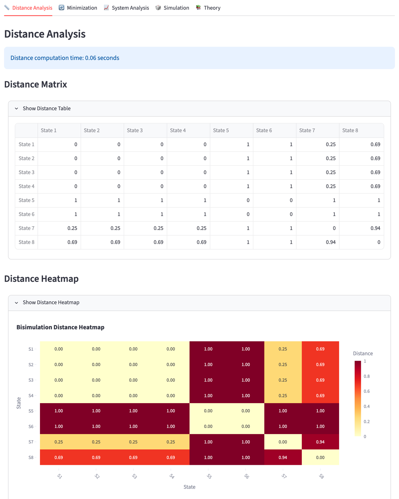

# Probabilistic Bisimulation Tool

My final-year dissertation at the University of Sheffield, supervised by [Dr Harsh Beohar](https://sheffield.ac.uk/cs/people/academic/harsh-beohar). It was awarded a **Distinction**.

It's a Python tool for analysing probabilistic transition systems. It finds which states behave identically, measures how different the other states are, and shrinks systems down to their smallest equivalent form. You can use it through a web interface or the command line.



## The idea

A probabilistic transition system is a set of states where each move to a next state happens with some probability. These are used to model things like randomised algorithms and network protocols.

Two states are **bisimilar** if no one watching from the outside could tell them apart: they make the same moves with the same probabilities. That's useful, but it's all or nothing. If one probability is 0.5 and the other is 0.51, the states aren't bisimilar, even though they're almost the same.

My project computes **bisimulation distances** as well. Each pair of states gets a number between 0 (identical behaviour) and 1 (completely different). Most of the work was taking the theorems behind this from the literature and turning them into code that's correct and fast.

## What it does

- **Minimisation.** Groups states into equivalence classes by partition refinement, then builds the smaller system where each class is one state.
- **Distance matrix.** Computes the distance between every pair of states. It solves a Wasserstein (optimal transport) problem with SciPy's linear programming solver, and repeats until the values settle.
- **Explanations.** For any two states, shows why they differ: whether one terminates and the other doesn't, and which transitions contribute most to the distance.
- **Simulation.** Runs random walks from a state, or from two states side by side, to compare how they behave in practice.
- **Several input formats.** PRISM models (`.pm`), JSON, and a simple text format. Parsers are pluggable, so adding a new format is one class.

## How it's built

- **Core algorithms:** Python, NumPy, SciPy (`probisim/`)
- **Web interface:** Streamlit, with Plotly and Seaborn for the heatmaps and charts, and Graphviz for drawing the systems (`app.py`)
- **Command line:** Typer (`cli.py`)
- **Tests:** 66 pytest unit and integration tests. Coverage is 98% on the core algorithms, 97% on the parsers and 96% on the CLI.
- **Benchmarks:** timing runs on 3-, 20- and 50-state systems (`benchmarks/`)

The original pseudocode for each algorithm is in `pseudocode/`.

## Running it

You'll need Python 3.10 or newer. Graphviz is optional, and is only used for the system diagrams.

```bash
git clone https://github.com/bashirbobboi/Bisimulation.git
cd Bisimulation
python -m venv venv
source venv/bin/activate        # Windows: venv\Scripts\activate
pip install -r requirements.txt
```

**Web interface:**

```bash
streamlit run app.py
```

Then upload one of the files in `examples/`.

**Command line:**

```bash
python cli.py parse examples/knuth_die.pm prism --to die.json   # convert a model
python cli.py classes die.json                                  # equivalence classes
python cli.py dist die.json                                     # distance matrix
python cli.py explain die.json 1 2                              # why states 1 and 2 differ
python cli.py simulate die.json --start-state 1 --num-simulations 100
```

Run `python cli.py --help` to see every command.

**Tests:**

```bash
PYTHONPATH=. pytest --cov=probisim --cov=cli
```

## Author

Mohammed Bashir Bobboi: [bashir.is-a.dev](https://bashir.is-a.dev)
